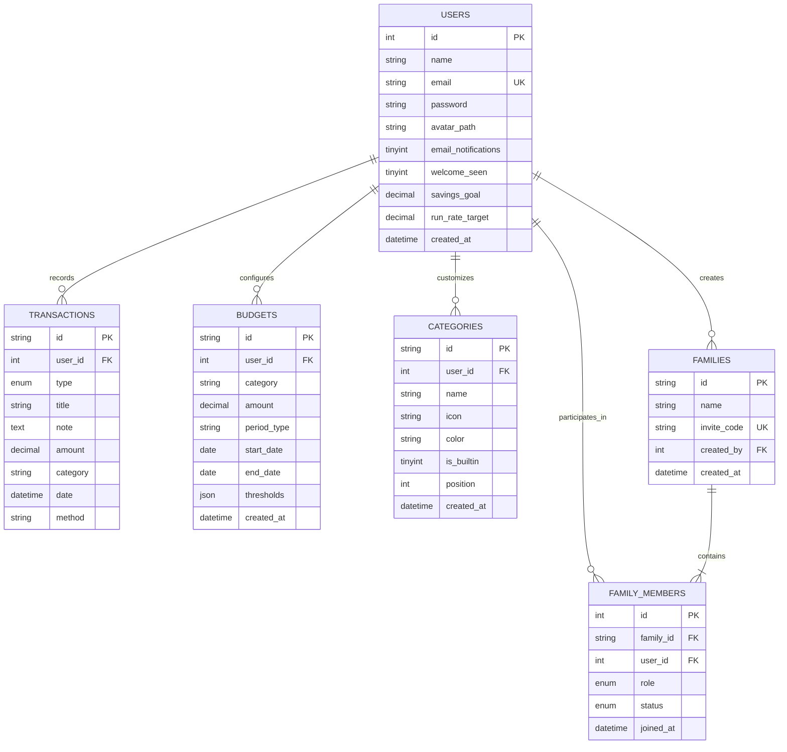
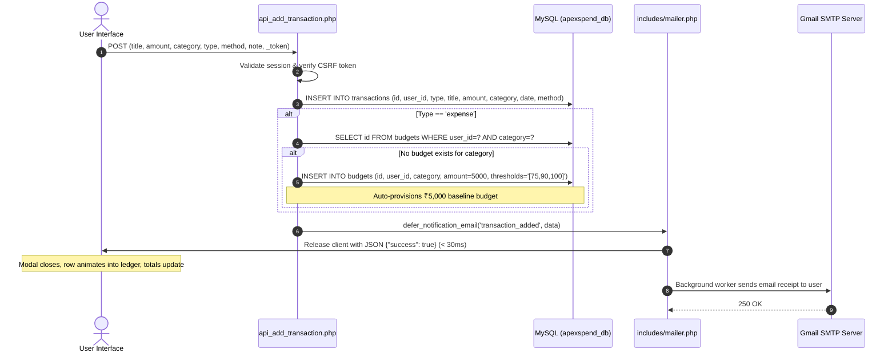
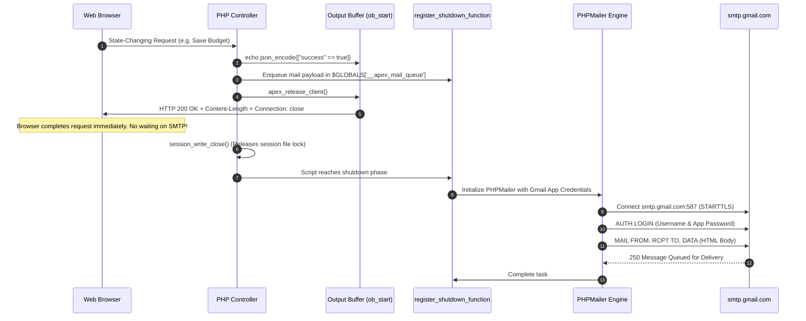
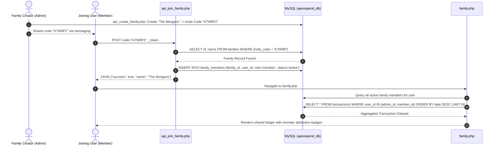
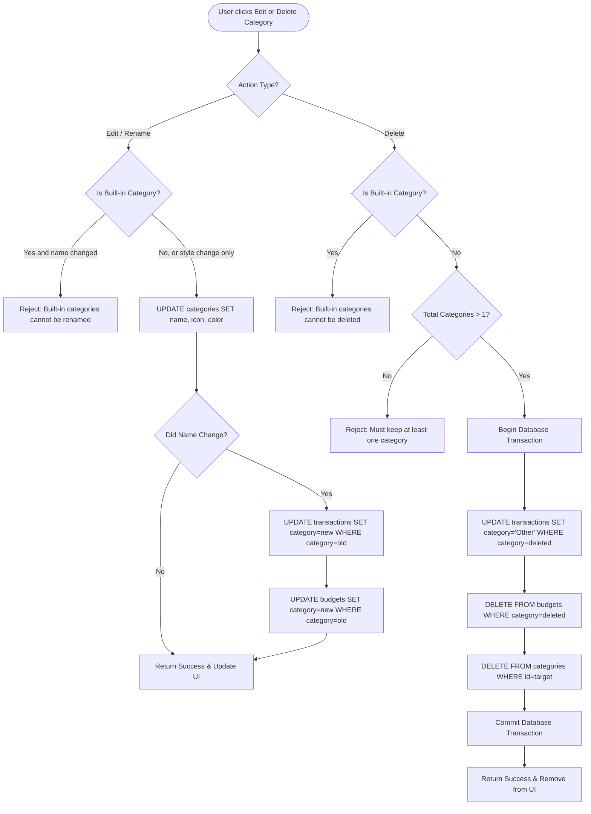

# ApexSpend — Comprehensive Architectural Specification & Master Documentation

> **Document Version:** 1.0.0  
> **Date:** October 29, 2026  
> **System Name:** ApexSpend (The Daily Ledger)  
> **Author & Maintainer:** [@karanRatiya123](https://github.com/karanRatiya123)  
> **Primary Technology Stack:** PHP 8.x, MySQL/MariaDB, Vanilla ES6+ JavaScript, Chart.js, CSS3 (OKLCH Design Tokens), PHPMailer  

---

## Table of Contents

1. [Executive Summary & System Philosophy](#1-executive-summary--system-philosophy)
2. [Complete Technology Stack & Dependencies](#2-complete-technology-stack--dependencies)
3. [System Architecture & Multi-Tier Topology](#3-system-architecture--multi-tier-topology)
4. [Complete Database Schema & Data Dictionary](#4-complete-database-schema--data-dictionary)
5. [Entity-Relationship (ER) Diagram](#5-entity-relationship-er-diagram)
6. [Core Engine & Security Subsystems](#6-core-engine--security-subsystems)
   - 6.1 [Session Management & Session Isolation](#61-session-management--session-isolation)
   - 6.2 [Anti-CSRF Protection Layer](#62-anti-csrf-protection-layer)
   - 6.3 [Database Abstraction & Graceful Degradation (Session Fallback)](#63-database-abstraction--graceful-degradation-session-fallback)
   - 6.4 [Indian Rupee (₹) Financial Formatting Algorithm](#64-indian-rupee--financial-formatting-algorithm)
   - 6.5 [Theme Engine (Dark / Light / System) & OKLCH Color Model](#65-theme-engine-dark--light--system--oklch-color-model)
   - 6.6 [Custom Accessible Component (`apex-select.js`)](#66-custom-accessible-component-apex-selectjs)
7. [Asynchronous Non-Blocking Email Pipeline](#7-asynchronous-non-blocking-email-pipeline)
   - 7.1 [The SMTP Round-Trip Problem](#71-the-smtp-round-trip-problem)
   - 7.2 [The Early-Flush & Shutdown Worker Architecture](#72-the-early-flush--shutdown-worker-architecture)
   - 7.3 [Notification Events & HTML Email Templates](#73-notification-events--html-email-templates)
8. [Comprehensive Feature & Page Specifications](#8-comprehensive-feature--page-specifications)
   - 8.1 [Authentication & Access Control (`login.php`, `auth.php`, `logout.php`)](#81-authentication--access-control-loginphp-authphp-logoutphp)
   - 8.2 [Executive Overview Dashboard (`dashboard.php`, `app.js`)](#82-executive-overview-dashboard-dashboardphp-appjs)
   - 8.3 [The Financial Ledger (`transactions.php`, `transactions.js`)](#83-the-financial-ledger-transactionsphp-transactionsjs)
   - 8.4 [Budget Management & Threshold Monitoring (`budgets.php`, `budgets.js`)](#84-budget-management--threshold-monitoring-budgetsphp-budgetsjs)
   - 8.5 [Custom Category Registry (`categories.php`, `categories.js`, `includes/categories.php`)](#85-custom-category-registry-categoriesphp-categoriesjs-includescategoriesphp)
   - 8.6 [Collaborative Family Space (`family.php`, `family.js`)](#86-collaborative-family-space-familyphp-familyjs)
   - 8.7 [Financial Analytics Suite (`analytics.php`, `analytics.js`)](#87-financial-analytics-suite-analyticsphp-analyticsjs)
   - 8.8 [Account Profile, Preferences & Goals (`profile.php`, `profile.js`, `update_profile.php`)](#88-account-profile-preferences--goals-profilephp-profilejs-update_profilephp)
9. [RESTful Internal API Catalog](#9-restful-internal-api-catalog)
10. [End-to-End System Workflows & Data Flow Diagrams](#10-end-to-end-system-workflows--data-flow-diagrams)
    - 10.1 [User Registration, Welcome Flow & First Login](#101-user-registration-welcome-flow--first-login)
    - 10.2 [Transaction Creation & Automated Budget Allocation](#102-transaction-creation--automated-budget-allocation)
    - 10.3 [Asynchronous SMTP Mail Delivery Sequence](#103-asynchronous-smtp-mail-delivery-sequence)
    - 10.4 [Collaborative Family Space: Join & Ledger Aggregation](#104-collaborative-family-space-join--ledger-aggregation)
    - 10.5 [Category Renaming Cascade & Safe Deletion Workflow](#105-category-renaming-cascade--safe-deletion-workflow)
11. [Master Project File Matrix & Directory Map](#11-master-project-file-matrix--directory-map)
12. [Installation, Environment Setup & Deployment Guide](#12-installation-environment-setup--deployment-guide)

---

## 1. Executive Summary & System Philosophy

**ApexSpend** is a full-featured personal and collaborative financial management web application. Engineered with an editorial aesthetic (inspired by traditional broadsheet financial newspapers combined with contemporary minimalist interfaces), it avoids heavy JavaScript frameworks (React, Vue, Angular) and heavy PHP frameworks (Laravel, Symfony) in favor of **zero-build, ultra-lean Vanilla ES6+ JavaScript and modern native PHP 8.x**.

### Core Tenets of the Application
1. **Zero-Build Architecture:** No `webpack`, `vite`, `npm run build`, or transpilation steps. Changes to CSS, PHP, or JavaScript take effect immediately upon page reload.
2. **Editorial Typography & Dark/Light OKLCH Theming:** The aesthetic is driven by typography (`Instrument Serif`, `Geist`, and `Geist Mono`), razor-thin 1px hairline rules, and zero artificial dropshadows. Colors are calibrated using the modern OKLCH color space for uniform perceptual luminance across themes.
3. **Indian Rupee (₹) First-Class Representation:** All ledger calculations and presentation components strictly follow the Indian numbering system (lakhs and crores: `₹12,84,550.00`).
4. **Non-Blocking Asynchronous Notifications:** A custom background flush worker pattern enables notification emails (via Gmail SMTP) without causing the browser to hang during the 2–5 second SMTP round-trip.
5. **Collaborative Multi-Tenant Family Space:** Users can share ledgers without compromising account independence through 6-character cryptographic invite codes.
6. **Graceful Storage Degradation:** If MySQL/MariaDB is unreachable, the system automatically falls back to an in-memory session database (`$_SESSION['users_db']`), preventing catastrophic white-screen crashes.

---

## 2. Complete Technology Stack & Dependencies

```
┌────────────────────────────────────────────────────────────────────────┐
│                        CLIENT / BROWSER TIER                           │
│  HTML5 + CSS3 (OKLCH Tokens) + Vanilla JS (ES6+)                       │
│  Typography: Instrument Serif, Geist, Geist Mono                       │
│  Icons: Font Awesome 6.4.0 (CDN)                                       │
│  Charts: Chart.js 4.x (CDN)                                            │
│  Components: apex-select.js (Accessible Custom Listbox)                │
└───────────────────────────────────┬────────────────────────────────────┘
                                    │ HTTP / HTTPS (XHR / Fetch / Forms)
                                    ▼
┌────────────────────────────────────────────────────────────────────────┐
│                       APPLICATION SERVER TIER                          │
│  Web Server: Apache 2.4+ (via XAMPP)                                   │
│  Language Runtime: PHP 8.0+ (Procedural / Native PDO)                  │
│  Security: CSRF Guard, Bcrypt Hasher, Session Isolation (.sessions/)   │
│  Asynchronous Pipeline: Output Buffer Flushing + FastCGI Release       │
│  Dependencies: PHPMailer 6.9+ (Installed via Composer)                 │
└───────────────────┬────────────────────────────────┬───────────────────┘
                    │ PDO MySQL                      │ SMTP TLS Port 587
                    ▼                                ▼
┌───────────────────────────────────┐  ┌─────────────────────────────────┐
│        DATA PERSISTENCE           │  │       EXTERNAL SERVICES         │
│  Database: MySQL / MariaDB        │  │  Google Gmail SMTP              │
│  Engine: InnoDB (utf8mb4)         │  │  (smtp.gmail.com:587)          │
│  Database Name: apexspend_db      │  │  App Password Auth              │
└───────────────────────────────────┘  └─────────────────────────────────┘
```

### Detailed Dependency Breakdown

| Component | Technology | Version | Purpose |
|---|---|---|---|
| **Backend Runtime** | PHP | 8.0 – 8.3 | Core server-side controllers, API endpoints, HTML templating |
| **Database** | MySQL / MariaDB | 10.4+ | Relational data persistence, foreign key cascades, JSON fields |
| **Web Server** | Apache HTTP Server | 2.4+ | Request routing, `.htaccess`, static asset delivery |
| **Email Transport** | PHPMailer | ^6.9 | RFC-compliant SMTP mailing over TLS with Gmail App Passwords |
| **Data Visualization** | Chart.js | 4.4.x | Renders Cash Flow line charts and Outflow doughnut charts |
| **Icons** | Font Awesome | 6.4.0 | Vector UI iconography and dynamic category badge icons |
| **Typography** | Google Fonts | Web | `Instrument Serif` (Editorial headings), `Geist` (Body), `Geist Mono` (Numbers) |
| **Color Space** | CSS Color Module Level 4 | Modern CSS | OKLCH color token definition for seamless Dark/Light palettes |

---

## 3. System Architecture & Multi-Tier Topology

ApexSpend is built on an event-driven, multi-tier architectural pattern. The system separates user presentation, business controllers, database execution, and asynchronous task offloading into well-defined boundaries:

```mermaid
graph TD
    subgraph Browser ["Client Presentation Tier (Browser)"]
        UI[User Interface Views]
        AS[apex-select.js Custom Listbox]
        TH[theme.js Engine]
        JS[Page Controllers: app.js, transactions.js, etc.]
    end

    subgraph Server ["Server Controller Tier (PHP 8.x)"]
        AUTH[auth.php & config.php]
        CSRF[CSRF Validator]
        API[api_*.php REST Endpoints]
        VIEWS[PHP View Templates: dashboard.php, etc.]
    end

    subgraph Async ["Asynchronous Delivery Pipeline"]
        REL[apex_release_client: HTTP 200 Flush]
        SHUT[register_shutdown_function]
        MAILER[includes/mailer.php]
        PHPMAIL[PHPMailer Engine]
    end

    subgraph Storage ["Persistence Tier"]
        MYSQL[(MySQL / MariaDB: apexspend_db)]
        FS[Filesystem: .sessions/ Session Store]
    end

    subgraph Cloud ["External Cloud Services"]
        SMTP[Google Gmail SMTP Gateway]
    end

    UI -->|HTML Form POST / AJAX Fetch| CSRF
    CSRF --> AUTH
    CSRF --> API
    API -->|Read / Write Prepared Queries| MYSQL
    VIEWS -->|Server-Side Render| UI
    AUTH -->|Session Read/Write| FS
    API -->|Enqueues Job| REL
    REL -->|Flushes Response to Browser| UI
    REL -->|Executes in Shutdown Phase| SHUT
    SHUT --> MAILER
    MAILER --> PHPMAIL
    PHPMAIL -->|Encrypted TLS (Port 587)| SMTP
```

---

## 4. Complete Database Schema & Data Dictionary

The application operates on a single consolidated MySQL database named `apexspend_db`. All tables utilize the `InnoDB` storage engine with `utf8mb4` character set encoding.

### Table 1: `users`
Stores user profile information, authentication credentials, onboarding states, financial targets, and notification preferences.

| Column Name | Data Type | Nullable | Default | Description |
|---|---|---|---|---|
| `id` | `INT` | NO | `AUTO_INCREMENT` | Primary Key, unique user identifier |
| `name` | `VARCHAR(100)` | NO | None | Full legal or display name |
| `email` | `VARCHAR(100)` | NO | None | Unique login email address |
| `password` | `VARCHAR(255)` | NO | None | Bcrypt-hashed password string (`$2y$10$...`) |
| `avatar_path` | `VARCHAR(255)` | YES | `NULL` | Relative path to user avatar image |
| `email_notifications` | `TINYINT(1)` | NO | `1` | Global toggle: `1` = Send emails, `0` = Opt out |
| `welcome_seen` | `TINYINT(1)` | NO | `0` | One-time onboarding card flag: `0` = Show, `1` = Dismissed |
| `savings_goal` | `DECIMAL(15,2)`| YES | `50000.00` | Target monthly savings amount in Indian Rupees |
| `run_rate_target` | `DECIMAL(15,2)`| YES | `1000000.00` | Target annual gross income run-rate in INR |
| `created_at` | `DATETIME` | YES | `CURRENT_TIMESTAMP` | Account creation timestamp |

### Table 2: `transactions`
The immutable financial ledger recording every debit (expense) and credit (income).

| Column Name | Data Type | Nullable | Default | Description |
|---|---|---|---|---|
| `id` | `VARCHAR(50)` | NO | None | Primary Key; prefixed unique string (`tx_65...`) |
| `user_id` | `INT` | NO | None | Foreign Key referencing `users(id)` ON DELETE CASCADE |
| `type` | `ENUM('expense','income')` | NO | None | Nature of cashflow |
| `title` | `VARCHAR(255)` | NO | None | Merchant, payee, or employer description |
| `note` | `TEXT` | YES | `NULL` | Free-form contextual notes or item details |
| `amount` | `DECIMAL(15,2)`| NO | None | Financial value in INR |
| `category` | `VARCHAR(100)` | NO | None | Category name assigned to the transaction |
| `date` | `DATETIME` | NO | None | Exact timestamp when transaction occurred |
| `method` | `VARCHAR(100)` | YES | `NULL` | Payment channel (UPI, NEFT, RuPay, Cash, etc.) |

### Table 3: `budgets`
Defines monthly spending caps per category, including dynamic threshold trigger configurations.

| Column Name | Data Type | Nullable | Default | Description |
|---|---|---|---|---|
| `id` | `VARCHAR(50)` | NO | None | Primary Key; prefixed unique string (`bg_65...`) |
| `user_id` | `INT` | NO | None | Foreign Key referencing `users(id)` ON DELETE CASCADE |
| `category` | `VARCHAR(100)` | NO | None | Associated category name |
| `amount` | `DECIMAL(15,2)`| NO | None | Monthly spending threshold allowance in INR |
| `period_type` | `VARCHAR(50)` | NO | `'monthly'` | Time period scope (`'monthly'`, `'custom'`) |
| `start_date` | `DATE` | YES | `NULL` | Custom budget cycle starting date |
| `end_date` | `DATE` | YES | `NULL` | Custom budget cycle termination date |
| `thresholds` | `JSON` | YES | `NULL` | JSON array of warning percentages (e.g. `[75, 90, 100]`) |
| `created_at` | `DATETIME` | YES | `CURRENT_TIMESTAMP` | Record creation timestamp |

### Table 4: `families`
Stores collaborative group workspaces that pool multi-user transactions into a collective ledger.

| Column Name | Data Type | Nullable | Default | Description |
|---|---|---|---|---|
| `id` | `VARCHAR(50)` | NO | None | Primary Key; prefixed unique string (`fam_65...`) |
| `name` | `VARCHAR(100)` | NO | None | Display title of the family space (e.g., "The Morgans") |
| `invite_code` | `VARCHAR(10)` | NO | None | Unique 6-character cryptographic joining token |
| `created_by` | `INT` | NO | None | Foreign Key referencing `users(id)` ON DELETE CASCADE |
| `created_at` | `DATETIME` | YES | `CURRENT_TIMESTAMP` | Space creation timestamp |

### Table 5: `family_members`
Association table governing membership status, privileges, and relationships within a family space.

| Column Name | Data Type | Nullable | Default | Description |
|---|---|---|---|---|
| `id` | `INT` | NO | `AUTO_INCREMENT` | Primary Key |
| `family_id` | `VARCHAR(50)` | NO | None | Foreign Key referencing `families(id)` ON DELETE CASCADE |
| `user_id` | `INT` | NO | None | Foreign Key referencing `users(id)` ON DELETE CASCADE |
| `role` | `ENUM('admin','member')` | NO | `'member'` | Administrative privilege level |
| `status` | `ENUM('active','pending','rejected')` | NO | `'active'` | Membership standing |
| `joined_at` | `DATETIME` | YES | `CURRENT_TIMESTAMP` | Timestamp when user joined the family |

*Constraint:* Unique compound key on `(family_id, user_id)` prevents duplicate memberships.

### Table 6: `categories`
User-level and system-level spending category registry with icon assignments, color codes, and sort weights.

| Column Name | Data Type | Nullable | Default | Description |
|---|---|---|---|---|
| `id` | `VARCHAR(50)` | NO | None | Primary Key; prefixed unique string (`cat_65...`) |
| `user_id` | `INT` | NO | None | Foreign Key referencing `users(id)` ON DELETE CASCADE |
| `name` | `VARCHAR(100)` | NO | None | Name of category (e.g. "Food & Dining") |
| `icon` | `VARCHAR(60)` | NO | `'fa-tag'` | Font Awesome 6 solid class string |
| `color` | `VARCHAR(9)` | NO | `'#f59e0b'` | Hexadecimal color code for charts and badges |
| `is_builtin` | `TINYINT(1)` | NO | `0` | `1` = Core protected category, `0` = User custom category |
| `position` | `INT` | NO | `0` | Visual ordering index |
| `created_at` | `DATETIME` | YES | `CURRENT_TIMESTAMP` | Category creation timestamp |

*Constraint:* Unique compound key on `(user_id, name)` enforces unique category names per user.

---

## 5. Entity-Relationship (ER) Diagram



---

## 6. Core Engine & Security Subsystems

### 6.1 Session Management & Session Isolation
In standard XAMPP environments, PHP stores session files in the global system temporary directory (`C:\xampp\tmp` or `/tmp`), leading to potential session corruption or cross-project leakage. ApexSpend overrides this behavior in `config.php`:
- Creates a dedicated hidden `.sessions/` directory directly within the project root.
- Sets strict cookie parameters: `httponly = true` (blocks JavaScript XSS session hijacking), `samesite = 'Lax'` (mitigates CSRF vulnerabilities), and `path = '/'`.
- Auto-initializes on all requests via `session_start()`.

### 6.2 Anti-CSRF Protection Layer
State-changing HTTP operations (POST requests to forms or API endpoints) are protected by a synchronized anti-CSRF token token system:
- **Generation:** `csrf_token()` generates a 256-bit cryptographically secure pseudorandom token via `bin2hex(random_bytes(32))` and anchors it in `$_SESSION['csrf_token']`.
- **Injection:** Rendered in traditional HTML forms using `<input type="hidden" name="_token" value="<?= csrf_token() ?>">` or emitted via `<meta name="csrf-token" content="...">` for JavaScript fetch calls.
- **Verification:** `csrf_validate()` executes at the entry point of every state-altering script. It reads the token from `$_POST['_token']` or the `X-CSRF-Token` HTTP header. Tokens are verified using `hash_equals()`, which provides timing-attack resistance.
- **AJAX vs Form Failure:** AJAX requests receive an immediate `HTTP 403 Forbidden` JSON payload (`{"success": false, "error": "Invalid CSRF token"}`), while traditional form submits are redirected back to the referer with a session flash error.

### 6.3 Database Abstraction & Graceful Degradation (Session Fallback)
The database connection function `getDBConnection()` uses a static memoized PDO instance. If MySQL fails (e.g. database service stopped or not yet configured), the application catches the `PDOException` and falls back gracefully to `$_SESSION['users_db']`.
- Seed data for demo user "Alex Morgan" (`demo@apexspend.com`) is injected into the PHP session.
- Allows team members or evaluators to test UI mechanics and navigation even in the absence of an active database server.

### 6.4 Indian Rupee (₹) Financial Formatting Algorithm
ApexSpend standardizes on Indian numbering formatting across both PHP and JavaScript:
- **Format Rule:** Unlike Western formatting (grouping by thousands: `1,000,000.00`), the Indian system formats the rightmost group of three digits, followed by recurring groups of two digits (Lakhs and Crores: `10,00,000.00`).
- **PHP Implementation:** Handled via helper `format_inr($amount)`:
  ```php
  function format_inr($n) {
      return number_format((float)$n, 2, '.', ',');
  }
  ```
- **JavaScript Implementation:** Managed via `formatINR(val)` in `app.js` using regular expressions:
  ```javascript
  function formatINR(val) {
      let parts = Number(val).toFixed(2).split('.');
      let integerPart = parts[0];
      let decimalPart = parts[1];
      let lastThree = integerPart.substring(integerPart.length - 3);
      let otherNumbers = integerPart.substring(0, integerPart.length - 3);
      if (otherNumbers !== '') lastThree = ',' + lastThree;
      return otherNumbers.replace(/\B(?=(\d{2})+(?!\d))/g, ',') + lastThree + '.' + decimalPart;
  }
  ```

### 6.5 Theme Engine (Dark / Light / System) & OKLCH Color Model
ApexSpend features a zero-FOUC (Flash of Unstyled Content) theme switcher:
- **No-FOUC Guard:** An inline IIFE executes synchronously in the document `<head>` before any DOM elements are rendered, checking `localStorage.getItem('apex-theme')` or system preference media query, and setting `data-theme` on the root `<html>` element.
- **System Sync:** Listens to `window.matchMedia('(prefers-color-scheme: light)')` to follow OS-level dark/light mode switches automatically when set to "System".
- **OKLCH Design Tokens:** Defined in `style.css`, OKLCH guarantees consistent lightness across hues:
  - Dark Mode: Surface `oklch(0.14 0.01 260)`, Ink `oklch(0.96 0.01 260)`, Muted `oklch(0.60 0.01 260)`.
  - Light Mode: Surface `oklch(0.98 0.005 260)`, Ink `oklch(0.15 0.01 260)`, Muted `oklch(0.45 0.01 260)`.

### 6.6 Custom Accessible Component (`apex-select.js`)
Native browser `<select>` dropdowns cannot be styled cleanly with icons or custom colors. `apex-select.js` automatically upgrades every `.input-shell select` into a customized dropdown listbox:
- Hides the native `<select>` element while keeping it active in the DOM so that standard form submissions and serialization continue to work.
- Injects a floating popper panel with custom category icons, hex badges, and payment method icons.
- Complete keyboard accessibility: navigation with `Up`/`Down` arrows, `Home`, `End`, `Enter` to select, `Escape` to close, and instant typeahead matching.
- Observes DOM mutations so dynamically added categories appear instantly without full reloads.

---

## 7. Asynchronous Non-Blocking Email Pipeline

### 7.1 The SMTP Round-Trip Problem
Synchronous SMTP transmission via third-party mail gateways (such as `smtp.gmail.com:587`) introduces an unavoidable latency of 1,500ms to 4,000ms due to TCP handshakes, TLS negotiation, and remote SMTP queue acknowledgment. If handled synchronously during an HTTP POST, the user experiences significant UI lag after clicking "Save" or "Delete".

### 7.2 The Early-Flush & Shutdown Worker Architecture
ApexSpend resolves this bottleneck with an innovative asynchronous response flushing mechanism implemented in `includes/mailer.php`:

```
User Click (POST)
       │
       ▼
Controller executes DB queries (10-20ms)
       │
       ▼
`defer_notification_email($type, $data)` enqueues mail task
       │
       ▼
`apex_release_client()` flushes output buffer & sends headers:
  - Header: Connection: close
  - Header: Content-Length: <size>
  - Calls: fastcgi_finish_request() or ob_end_flush() + flush()
       │
       ▼
BROWSER RECEIVES HTTP 200 JSON RESPONSE (Total Latency: < 40ms)
       │
       ▼  [HTTP Connection Terminated — User interface remains smooth]
Server enters PHP Shutdown Phase:
  - Calls session_write_close() (frees session file lock)
  - register_shutdown_function executes queued jobs
  - PHPMailer establishes TLS session with smtp.gmail.com:587
  - Email delivered in background
```

### 7.3 Notification Events & HTML Email Templates
The system includes 11 dedicated, responsive HTML email templates configured in `includes/email_templates.php`:

| Event Trigger | Email Subject Line | Embedded Context Data |
|---|---|---|
| `welcome` | Welcome to ApexSpend, {Name} | User name, login link, setup tips |
| `transaction_added` | Transaction Added: ₹{Amount} · {Title} | Title, formatted INR amount, category, method, notes |
| `transaction_updated`| Transaction Updated: ₹{Amount} · {Title} | Updated amount, merchant title, category, payment method |
| `transaction_deleted`| Transaction Deleted: ₹{Amount} · {Title} | Snapshot of removed transaction title, category, and value |
| `budget_saved` | Budget Updated: {Category} · ₹{Amount} | Category, new limit allowance, period type, threshold alert levels |
| `budget_deleted` | Budget Deleted: {Category} | Category name removed from active monitoring |
| `family_created` | Family Space Created: {Family Name} | Space name, 6-character cryptographic invite code |
| `family_joined` | You joined {Family Name} on ApexSpend | Confirmation of joined group space, link to shared ledger |
| `family_left` | You left {Family Name} | Notice of departure and revocation of shared access |
| `profile_updated` | Your ApexSpend profile was updated | Updated legal name and registered contact email |
| `password_changed` | Security Alert: Your password was changed | Security alert with timestamp and breach mitigation instructions |

---

## 8. Comprehensive Feature & Page Specifications

### 8.1 Authentication & Access Control (`login.php`, `auth.php`, `logout.php`)
- **Single Auth Portal:** `login.php` provides a unified interface with client-side tabs toggling between "Sign in" and "Create account".
- **Signup Validation:**
  - Enforces minimum 6-character password length.
  - Validates email syntax via PHP `FILTER_VALIDATE_EMAIL`.
  - Checks for unique email constraints.
  - Automatically initializes category registries and flags `welcome_seen = 0`.
  - Triggers asynchronous `welcome` email notification upon completion.
- **Login Authentication:**
  - Verifies credentials using `password_verify($password, $hash)`.
  - On success, regenerates the session ID to prevent session fixation attacks.
  - Hydrates `$_SESSION['user']` with user identity, notification preferences, and goal targets.
- **Sign Out:** `logout.php` unsets all `$_SESSION` variables, destroys the session file in `.sessions/`, deletes the session cookie, and redirects to `login.php`.

### 8.2 Executive Overview Dashboard (`dashboard.php`, `app.js`)
- **Masthead & Net Balance:**
  - Computes net balance ($Total_{in} - Total_{out}$) across all historical records.
  - Calculates percentage trend comparison against the previous calendar month.
  - Features quick-action triggers: "New entry" modal and "Export" (`window.print()`).
- **Onboarding Card (New Accounts):**
  - Displays conditionally if `welcome_seen === 0`.
  - Outlines 3 steps: 1) Add first entry, 2) Set a budget, 3) Create a family space.
  - Includes a "Got it" button that fires an AJAX POST to `api_dismiss_welcome.php`, setting `welcome_seen = 1` permanently.
- **KPI Metrics Strip:**
  - **Cell 1 (Monthly Income):** Total earnings for current month, percentage trend vs. prior month, and a 6-month historical sparkline bar chart highlighting peak earnings.
  - **Cell 2 (Monthly Outflows):** Total expenses for current month, percentage trend vs. prior month, and a 6-month historical sparkline bar chart highlighting peak spending.
  - **Cell 3 (Saved This Month):** Net difference ($Income_{month} - Outflows_{month}$), percentage progress against the user's monthly savings goal, and a progress bar. Includes a gear icon to edit goals inline.
  - **Cell 4 (Annual Run-Rate):** Gross projected income ($Income_{month} \times 12$), progress towards the annual run-rate target, and progress bar with quick edit access.
- **Financial Goals Modal:**
  - Allows modal editing of `savings_goal` and `run_rate_target`.
  - Submits via AJAX to `api_update_goals.php`, updating both the database and active session.
- **Signature GitHub-Style Spending Contribution Heatmap:**
  - Displays a 53-week × 7-day contribution matrix (371 cells) representing the past 12 months.
  - Aggregates daily outflows and maps them to 5 intensity levels:
    - Level 0: ₹0 (No spending)
    - Level 1: ₹1 – ₹500
    - Level 2: ₹501 – ₹2,000
    - Level 3: ₹2,001 – ₹5,000
    - Level 4: > ₹5,000
  - Hovering over any cell reveals a dynamic tooltip displaying the exact date, formatted INR spending amount, and transaction count.
- **Recent Activity Ledger:**
  - Displays the 10 most recent transactions with merchant title, category pill, relative date, and amount.

### 8.3 The Financial Ledger (`transactions.php`, `transactions.js`)
- **Filterable Data Grid:** Complete chronological ledger showing Date, Merchant Title, Category (with icon & color badge), Payment Method, Note, and Amount.
- **Client-Side Live Search:** Real-time search filter matching title and notes without requiring server round-trips.
- **Multi-Dimensional Filters:**
  - Type Filter: All, Expense Only, Income Only.
  - Category Filter: Dynamic dropdown populated with user's categories.
  - Date Scope Filter: All Time, This Month, Last 30 Days, Year-to-Date.
- **Transaction CRUD Operations:**
  - **Create:** "New entry" modal supporting transaction type, title, amount, category, method, custom note, and datetime picker.
  - **Auto-Budget Generation:** Adding an expense to a category that does not yet have a budget automatically provisions a baseline budget of ₹5,000 with standard `[75, 90, 100]` thresholds.
  - **Edit:** Click any row to open the edit modal, pre-populated with transaction data. Submits to `api_update_transaction.php`.
  - **Delete:** Clicking the delete icon prompts confirmation, calls `api_delete_transaction.php`, removes the row with an animation, updates summaries, and triggers an email receipt.

### 8.4 Budget Management & Threshold Monitoring (`budgets.php`, `budgets.js`)
- **Category Budget Cards:** Displays all active category allowances alongside current month expenditures.
- **3-Tier Warning Thresholds:**
  - **Safe (0% – 74%):** Visual accent bar displays category brand color.
  - **Warning (75% – 89%):** Visual amber alert bar indicating approaching limit.
  - **Caution (90% – 99%):** Visual orange-red alert indicating critical limit.
  - **Exceeded ($\ge$ 100%):** Visual crimson alert bar with overflow indicator displaying overspend amount in INR.
- **Budget Actions:**
  - Add or update monthly category caps via `api_save_budget.php`.
  - Delete budgets via `api_delete_budget.php`.

### 8.5 Custom Category Registry (`categories.php`, `categories.js`, `includes/categories.php`)
- **Built-in Core Categories:** Initialized automatically on first account access:
  1. Food & Dining (`fa-utensils`, `#f59e0b`)
  2. Housing & Utilities (`fa-bolt`, `#3b82f6`)
  3. Shopping & Retail (`fa-bag-shopping`, `#a855f7`)
  4. Transportation (`fa-car`, `#4ade80`)
  5. Entertainment (`fa-film`, `#ec4899`)
  6. Health & Medical (`fa-briefcase-medical`, `#22d3ee`)
  7. Income (`fa-money-bill-wave`, `#8a8a8a`)
- **Custom Category Customization:**
  - Users can create new custom categories with custom names, custom icons (from a whitelist of 45+ Font Awesome 6 icons), and custom colors (from a curated 12-color palette).
  - Built-in categories cannot be deleted or renamed, but their colors and icons can be customized.
- **Cascade on Rename:**
  - Renaming a custom category automatically updates all historical transactions and existing budgets using that category name via `api_save_category.php`.
- **Safe Deletion Guard:**
  - Deleting a category automatically reassigns all past transactions in that category to `"Other"` so financial history remains intact. Associated budgets are cleaned up safely.

### 8.6 Collaborative Family Space (`family.php`, `family.js`)
- **Access Veil / Lock Screen:**
  - Users not belonging to any family space see a lock screen overlay with options to "Create family", "Join family", or "Peek behind" (demo preview).
- **Family Creation:**
  - Entering a name creates a new family record and generates an unambiguous 6-character alphanumeric invite code (using characters `ABCDEFGHJKMNPQRSTUVWXYZ23456789`).
  - Assigns creator the `admin` role.
- **Family Joining:**
  - Entering an invite code joins the user to the family as a `member`.
- **Shared Financial Feed:**
  - Aggregates the last 60 transactions across all active family members into a combined household feed.
  - Displays member name tags alongside each transaction.
- **Member Roster & Permissions:**
  - Lists all members with role badges (`admin` or `member`) and join dates.
  - Clicking a member opens a profile modal displaying their total contributions, expense vs income breakdown, and top spending category.
  - Admins can remove members via `api_remove_member.php`.
  - Members can voluntarily leave via `api_leave_family.php`. When the last member leaves, the family record is automatically pruned.

### 8.7 Financial Analytics Suite (`analytics.php`, `analytics.js`)
- **Executive Metric Panels:**
  - Net Cash Flow for the active period.
  - Average Daily Spend.
  - Overall Savings Rate percentage.
  - Largest Single Expense Record.
  - Most Frequent Merchant.
  - Dominant Payment Channel.
- **Interactive Visualizations (Chart.js):**
  - **Cash Flow Trend (Line Chart):** Compares monthly income vs monthly expenses with smooth cubic interpolation curves and fill gradients.
  - **Outflow Distribution (Doughnut Chart):** Displays spending distribution across categories, with slice colors matching user-defined category palette colors.
- **Spending Behavior Analytics:**
  - **Day-of-Week Distribution:** Bar breakdown tracking spending patterns from Monday to Sunday.
  - **Payment Method Share:** Visual breakdown showing payment methods used (UPI, Credit Cards, NEFT/IMPS, Cash).
  - **Recurring Expenses & Top Merchants:** Identifies merchants with 2 or more transactions to highlight recurring bills and subscriptions.

### 8.8 Account Profile, Preferences & Goals (`profile.php`, `profile.js`, `update_profile.php`)
- **Account Identity Card:** Shows user avatar initials, registration date, days active, total lifetime transactions, and active budgets.
- **Personal Information Management:** Update display name and email address with duplicate email prevention.
- **Security & Password Management:** Update password with current password verification, 6-character minimum enforcement, and Bcrypt re-hashing. Triggers an email security alert.
- **Notification Preferences:** Toggle email notifications ON/OFF. Persisted instantly via AJAX to `api_toggle_email.php`.
- **Theme Selection:** Switch between Dark, Light, and System modes with immediate visual preview.

---

## 9. RESTful Internal API Catalog

All API endpoints are located in the project root directory, accept POST or GET requests, enforce session authentication, and validate anti-CSRF tokens for all state-changing operations.

| Endpoint | Method | Required Parameters | Return Type | Description |
|---|---|---|---|---|
| `api_add_transaction.php` | `POST` | `title`, `amount`, `category`, `type`, `method`, `note`, `_token` | `JSON` | Creates a new transaction; auto-creates baseline budget if unbudgeted |
| `api_update_transaction.php` | `POST` | `id`, `title`, `amount`, `category`, `type`, `date`, `method`, `note`, `_token` | `JSON` | Updates an existing transaction record |
| `api_delete_transaction.php` | `POST` | `id`, `_token` | `JSON` | Deletes transaction record and queues deletion email |
| `api_get_budgets.php` | `GET` | *(Session Cookie)* | `JSON` | Fetches active budgets and current month spending progress |
| `api_save_budget.php` | `POST` | `id`, `category`, `amount`, `period_type`, `thresholds`, `_token` | `JSON` | Inserts or updates a category budget limit |
| `api_delete_budget.php` | `POST` | `id`, `_token` | `JSON` | Deletes a budget allocation |
| `api_get_categories.php` | `GET` | *(Session Cookie)* | `JSON` | Retrieves user's category list with icons and colors |
| `api_save_category.php` | `POST` | `name`, `icon`, `color`, `id` (optional), `_token` | `JSON` | Creates/updates category; cascades renames across transactions/budgets |
| `api_delete_category.php` | `POST` | `id`, `_token` | `JSON` | Deletes custom category; reassigns past transactions to "Other" |
| `api_create_family.php` | `POST` | `name`, `_token` | `JSON` | Creates family space and returns 6-character invite code |
| `api_join_family.php` | `POST` | `code`, `_token` | `JSON` | Joins a family space using invite code |
| `api_leave_family.php` | `POST` | `family_id` (optional), `_token` | `JSON` | Leaves family space; deletes family if last member |
| `api_get_member.php` | `GET` | `family_id`, `user_id` | `JSON` | Fetches a family member's isolated financial metrics and ledger |
| `api_remove_member.php` | `POST` | `family_id`, `user_id`, `_token` | `JSON` | Admin-only endpoint to remove a family member |
| `api_update_goals.php` | `POST` | `savings_goal`, `run_rate_target`, `_token` | `JSON` | Updates monthly savings goal and annual run-rate target |
| `api_toggle_email.php` | `POST` | `enabled` (`1` or `0`), `_token` | `JSON` | Toggles user email notification preferences |
| `api_dismiss_welcome.php` | `POST` | `_token` | `JSON` | Dismisses one-time welcome onboarding card (`welcome_seen = 1`) |

---

## 10. End-to-End System Workflows & Data Flow Diagrams

### 10.1 User Registration, Welcome Flow & First Login

```mermaid
sequenceDiagram
    autonumber
    actor User as User Browser
    participant Auth as auth.php
    participant DB as MySQL (apexspend_db)
    participant Mailer as includes/mailer.php
    participant SMTP as Gmail SMTP Server

    User->>Auth: POST action=signup (name, email, password, _token)
    Auth->>Auth: csrf_validate() & sanitize input
    Auth->>DB: SELECT id FROM users WHERE email = ?
    alt Email already exists
        DB-->>Auth: Record found
        Auth-->>User: Redirect login.php?tab=signup (Flash Error)
    else Email is unique
        Auth->>Auth: password_hash(password, PASSWORD_BCRYPT)
        Auth->>DB: INSERT INTO users (name, email, password, welcome_seen=0)
        Auth->>DB: INSERT INTO categories (built-in seeds for user)
        Auth->>Mailer: queue_welcome_email(name, email)
        Mailer->>User: Flush HTTP 302 Redirect to login.php?tab=login
        Note over Mailer,SMTP: HTTP connection closed; user sees login screen instantly
        Mailer->>SMTP: Connect TLS port 587 & send Welcome Email
        SMTP-->>Mailer: 250 Message accepted
    end
```

---

### 10.2 Transaction Creation & Automated Budget Allocation



---

### 10.3 Asynchronous SMTP Mail Delivery Sequence



---

### 10.4 Collaborative Family Space: Join & Ledger Aggregation



---

### 10.5 Category Renaming Cascade & Safe Deletion Workflow



---

## 11. Master Project File Matrix & Directory Map

```
EXPENSE TRACKING WEBSITE/
├── index.php                      # Application Entry Point (Redirects to dashboard.php)
├── config.php                     # DB connection, custom session config, CSRF helpers
├── auth.php                       # Authentication handler (Login, Signup, Session start)
├── logout.php                     # Session destruction and logout handler
├── update_profile.php             # Profile details and password change endpoint
├── database.sql                   # Complete DDL schema and seed dataset
├── style.css                      # Master design system (OKLCH tokens, layouts, components)
├── theme.js                       # Theme switcher engine (Dark / Light / System)
├── apex-select.js                 # Custom accessible listbox component
├── category-helper.js             # Shared category option rendering helper
├── quickadd.js                    # Inline category creator for transaction modals
├── script.js                      # Toast helper shared across pages
│
├── Views (User-Facing Pages)
│   ├── dashboard.php              # KPI tiles, sparklines, spending heatmap, recent ledger
│   ├── transactions.php           # Filterable transaction ledger and CRUD modals
│   ├── analytics.php              # Monthly trend line chart, category doughnut chart
│   ├── budgets.php                # Per-category monthly budgets & threshold progress bars
│   ├── categories.php             # Custom category management interface
│   ├── family.php                 # Collaborative family space and shared household ledger
│   ├── login.php                  # Tabbed authentication portal (Sign in / Sign up)
│   └── profile.php                # User settings, preferences, goals, and security
│
├── Client Scripts (Page-Specific JS)
│   ├── app.js                     # Dashboard heatmap builder, sparklines, goal editors
│   ├── transactions.js            # Ledger filters, search, modal wiring, CRUD handlers
│   ├── analytics.js               # Chart.js initialization, palette synchronization
│   ├── budgets.js                 # Budget progress calculations, threshold indicators
│   ├── categories.js              # Category picker, swatch selector, CRUD interactions
│   ├── family.js                  # Invite code generation, space join/leave flows
│   └── profile.js                 # Profile form validation, theme toggle, email switch
│
├── Backend API Endpoints (JSON)
│   ├── api_add_transaction.php    # Creates transaction, auto-provisions budgets
│   ├── api_update_transaction.php # Updates existing transaction records
│   ├── api_delete_transaction.php # Deletes transaction records
│   ├── api_get_budgets.php        # Retrieves budgets and calculated spending
│   ├── api_save_budget.php        # Inserts or updates budget limits
│   ├── api_delete_budget.php      # Removes budget limits
│   ├── api_get_categories.php     # Returns user's category list
│   ├── api_save_category.php      # Creates/updates category with rename cascade
│   ├── api_delete_category.php    # Deletes category; reassigns history to "Other"
│   ├── api_create_family.php      # Generates family space and 6-char invite code
│   ├── api_join_family.php        # Validates invite code and adds member
│   ├── api_leave_family.php       # Leaves family; prunes empty spaces
│   ├── api_get_member.php         # Fetches isolated member spending metrics
│   ├── api_remove_member.php      # Admin endpoint to remove family members
│   ├── api_update_goals.php       # Updates savings goal & run-rate target
│   ├── api_toggle_email.php       # Toggles email notification preference
│   └── api_dismiss_welcome.php    # Dismisses onboarding welcome card
│
├── includes/                      # Shared Backend Services
│   ├── mailer.php                 # Non-blocking async mail dispatcher & shutdown queue
│   ├── email_templates.php        # Responsive HTML email templates (11 events)
│   ├── email_prefs.php            # Email preference query & migration helpers
│   ├── welcome.php                # Welcome card visibility & dismissal helpers
│   └── categories.php             # Canonical category seeds, color palette, icon whitelist
│
└── Configuration & Credentials
    ├── mail_credentials.php       # Gmail address & App Password (untracked)
    ├── composer.json              # PHPMailer dependency specification
    └── .sessions/                 # Private server-side session file storage
```

---

## 12. Installation, Environment Setup & Deployment Guide

### Prerequisites
- **Apache Web Server 2.4+** and **MySQL 5.7+ / MariaDB 10.4+** (Shipped standard with XAMPP).
- **PHP 8.0 or higher** with `pdo_mysql`, `openssl`, and `mbstring` extensions enabled.
- **Composer** (PHP dependency manager) installed globally.

### Step-by-Step Setup

1. **Deploy to Web Root:**
   Copy the project directory into your web server's public root:
   ```bash
   # Windows (XAMPP default)
   C:\xampp\htdocs\EXPENSE TRACKING WEBSITE
   ```

2. **Start Web & Database Services:**
   Open the XAMPP Control Panel and start both **Apache** and **MySQL**.

3. **Database Initialization:**
   Open **phpMyAdmin** (`http://localhost/phpmyadmin/`) or MySQL CLI and import `database.sql`:
   ```sql
   mysql -u root -p < "C:\xampp\htdocs\EXPENSE TRACKING WEBSITE\database.sql"
   ```
   *Note: This creates the `apexspend_db` database and all required tables with initial demo records.*

4. **Install Dependencies:**
   Open a terminal in the project root and install PHPMailer:
   ```bash
   cd "C:\xampp\htdocs\EXPENSE TRACKING WEBSITE"
   composer install
   ```

5. **Configure Gmail SMTP Notifications (Optional):**
   To enable notification emails:
   - Enable 2-Step Verification on your Google Account.
   - Generate a 16-character App Password at [Google App Passwords](https://myaccount.google.com/apppasswords).
   - Create or edit `mail_credentials.php` in the project root:
     ```php
     <?php
     define('MAIL_USERNAME', 'your_actual_email@gmail.com');
     define('MAIL_PASSWORD', 'abcdefghijklmnop'); // 16-character App Password
     ```
   *Note: If credentials are not configured, the mailer skips delivery automatically with zero performance penalty.*

6. **Launch the Application:**
   Open your browser and navigate to:
   ```
   http://localhost/EXPENSE%20TRACKING%20WEBSITE/
   ```

7. **Default Demo Credentials:**
   - **Email:** `demo@apexspend.com`
   - **Password:** `password123`
   - Or click **Create account** to register a fresh profile.

---
*ApexSpend Documentation — Engineered for clarity, precision, and complete system transparency.*
